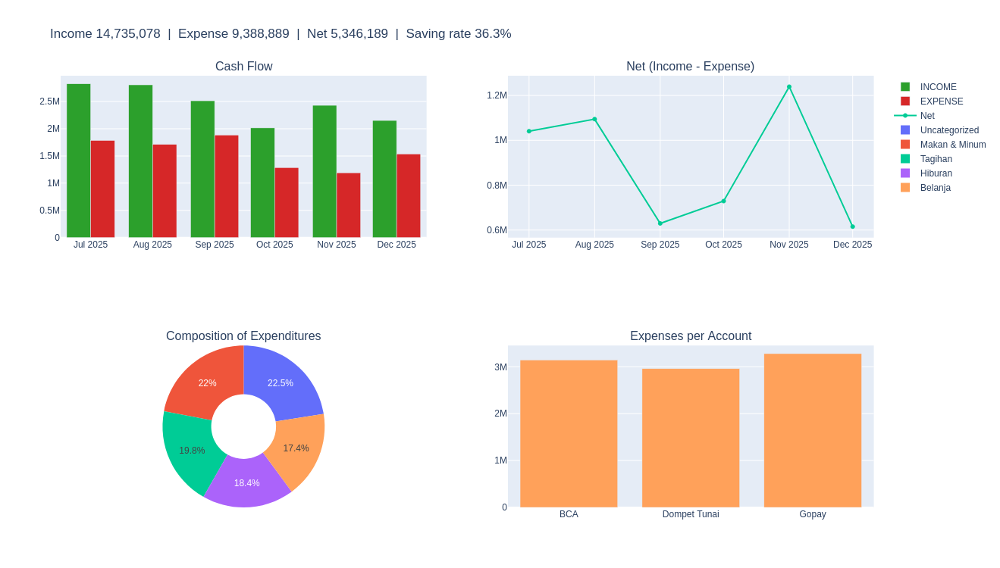

# Personal Finance Analysis and Expense Forecasting with Python

Analysis of six months of personal income and expense data (Jul-Dec 2025): monthly cash flow, spending by category and account, an interactive dashboard, and a 3-month expense forecast that compares three methods (moving average, linear trend, exponential smoothing) using backtested MAE.



## Key Findings

- **Cash flow:** total income of Rp14.74M against total expenses of Rp9.39M, an overall saving rate of about 36%. Monthly saving rate ranged from 25% (September) to 51% (November).
- **Spending:** spread fairly evenly across five categories (17-23% each). The largest bucket is "Uncategorized" (22.5%), followed by Food & Drinks (22.0%) and Bills (19.8%).
- **Forecast:** the 3-month moving average had the lowest backtested MAE (Rp342k) and predicts about Rp1.34M of expenses for January 2026. With only six months of data, the comparison between methods is indicative, not conclusive.

## What the Notebook Does

1. Loads and checks the data (data types, missing values).
2. Summarizes monthly income and expenses, and ranks expense categories.
3. Builds an interactive dashboard (Plotly + ipywidgets) with filters by month and account.
4. Forecasts the next 3 months of expenses using three methods and evaluates each with rolling-origin backtesting (MAE).
5. Plots the forecast with an uncertainty band of ± MAE.

## Dataset

[Data Finance 6 Bulan](https://www.kaggle.com/datasets/ugisugiman/data-finance) from Kaggle. Amounts are in Indonesian Rupiah (Rp).

by Ugi Sugiman, licensed CC0 (Public Domain).

Columns: `Date`, `Title`, `Amount`, `Type` (INCOME / EXPENSE), `Category`, `Account`.

The dataset is not included in this repository. Download it from Kaggle and place the CSV at `dataset/Data_Finance_6_Bulan.csv`.

## How to Run

```bash
# 1. clone the repository
git clone https://github.com/alfarizzy314/personal-finance-analysis.git
cd personal-finance-analysis

# 2. install dependencies
pip install -r requirements.txt

# 3. put the dataset in place (see Dataset section), then start Jupyter
jupyter notebook main.ipynb
```

Run all cells from top to bottom. The interactive dashboard requires a live Jupyter session; it will not render in GitHub's notebook preview.

## Project Structure

```
.
├── main.ipynb                      # analysis, dashboard, and forecasting
├── dataset/
│   └── Data_Finance_6_Bulan.csv    # download from Kaggle
├── images/
│   └── dashboard.png               # dashboard screenshot
├── requirements.txt
└── README.md
```

## Limitations

- Only six months of data, so the backtest has just three test points.
- The forecasting methods are simple baselines and do not model seasonality.
- A large share of spending is "Uncategorized", which limits category-level insight.

## Tech Stack

Python, pandas, NumPy, Plotly, ipywidgets, Jupyter.
